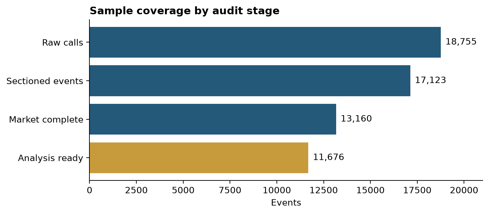
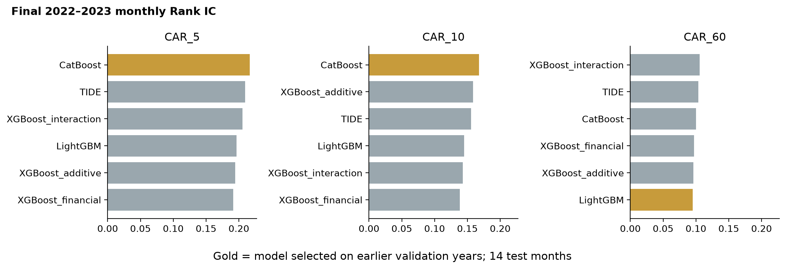
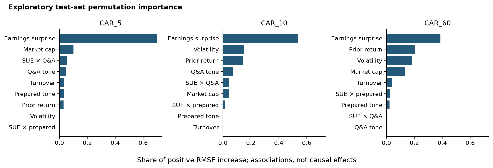

# Auditable PEAD Prediction Pipeline

An auditable earnings-call PEAD pipeline: event reconstruction, transcript segmentation, market and earnings features, and time-ordered model validation.


项目从 18,755 份原始业绩电话会记录出发，重建事件键、Prepared Remarks/Q&A 文本特征、事件时点对齐的市场变量和历史基本面变量，并使用训练期内验证与独立的后续测试期评估机器学习模型。





- 项目展示与中英文简历表述：[PORTFOLIO.md](PORTFOLIO.md)
- 复现命令与验收点：[REPRODUCIBILITY.md](REPRODUCIBILITY.md)
- 多人项目归属、AI 辅助与数据许可边界：[ATTRIBUTION.md](ATTRIBUTION.md)
- 工作区目录地图与可公开范围：[WORKSPACE_MAP.md](WORKSPACE_MAP.md)
- 不依赖私有数据的合成演示：`python scripts/run_synthetic_demo.py`
- 可公开的机器可读汇总审计：[public_audit_summary.json](reports/public_audit_summary.json)

本仓库展示的个人贡献是后续的数据重建、模型审计与可复现工程，不代表对原多人论文的独立署名或所有权主张。

## 技术说明

工作区将可公开代码、私有来源材料和 GitHub 发布物分开管理。`private/` 保留原多人论文和旧工作数据，`deliverables/github/` 仅保留经脱敏检查的公开包。可审计流程在第一阶段建立稳定事件键并隔离数据冲突；第二阶段验证原始会议文本并生成严格的 Prepared Remarks/Q&A 分段语料。

## 当前输入

- `private/legacy/master_dataset_multi_window.csv`：旧建模主表，仅用于审计比较
- `private/legacy/thesis_nlp_scores_new.csv`：旧全文 FinBERT 分数，仅用于审计比较
- `data/raw/motley-fool-data.pkl`：已核验的 18,755 行原始会议文本

## 运行

```powershell
python scripts/run_phase1.py
python -m pytest -q
```

运行脚本不会覆盖原文件。输出包括：

- `data/interim/master_events_audited.csv`：逐行事件审计表
- `data/interim/nlp_scores_audited.csv`：NLP 分数审计表
- `data/processed/events_unique_safe.csv`：可唯一确定的事件
- `data/processed/events_conflicts.csv`：同一事件键对应不同数值的记录
- `data/processed/events_unresolved_timestamps.csv`：无法恢复准确会议时间的记录
- `reports/phase1_data_quality.json`：机器可读质量报告
- `reports/phase1_data_quality.md`：人工审阅报告

运行第二阶段：

```powershell
python scripts/run_phase2.py
```

新增输出：

- `data/interim/transcripts_audited.csv`：逐行语料、哈希与分段审计
- `data/processed/transcript_sections.jsonl.gz`：唯一安全事件的压缩 Prepared/Q&A 语料
- `data/processed/transcripts_manual_review.csv`：冲突、重复冗余及分段不完整记录
- `reports/phase2_transcript_quality.json`：机器可读语料质量报告
- `reports/phase2_transcript_quality.md`：第二阶段人工审阅报告

第二阶段只接受显式的 Prepared Remarks 与 Questions/Answers 标题，并要求两个章节各不少于 20 词。无标题、正文为空、过短、事件冲突及重复冗余记录均不会进入模型语料。

## 事件键

事件键由标准化股票代码和美国东部时间的会议时间生成。旧主表中被压成午夜 `0:00` 的时间，只在 NLP 表对同一股票、同一日期存在唯一非午夜候选时恢复；否则进入人工复核。没有成功解析或恢复时间的行使用独立的未解析键，不会与其他记录合并。会议时间同时被标记为盘前、盘中或盘后，为下一阶段确定收益窗口起点提供依据。

源数据中少数 ticker 带有抓取残留的尾部右括号（如 `CIB)`）。审计表保留原值，事件键使用删除该无效字符后的标准 ticker。

## 第三阶段 FinBERT

第三阶段使用固定提交的 `ProsusAI/finbert`，按 512 tokens 切窗、64 tokens 重叠，对 Prepared Remarks 与 Q&A 分别计算 `P(positive)-P(negative)`。重叠窗口按新增 token 数加权；CUDA FP16、事件 batch 8、窗口 batch 16 均进入配置哈希。脚本按事件保存检查点，支持中断后继续：

```powershell
.venv\Scripts\python.exe scripts\run_phase3.py
```

依赖版本记录在 `requirements-phase3.txt`。最终输出为 `data/processed/finbert_section_scores.csv`，质量报告写入 `reports/phase3_finbert_quality.md`。

## 第四阶段市场变量

第四阶段从 Yahoo Finance 下载并逐股票缓存日频行情，使用 SPY 作为市场基准。盘前会议从当日开始计算漂移，盘中和盘后会议从下一交易日开始；CAR 使用个股与 SPY 的复权收盘日收益差，并在 5、10、60 个交易日窗口内算术累加：

```powershell
.venv\Scripts\python.exe scripts\run_phase4.py
```

旧数据中的 `SUE_Proxy` 实际是公告前 60 个交易日收益之和，第四阶段将其改名为 `PreRet_60`。旧 `Turnover` 是平均成交量对数，旧 `Size` 是价格与成交量乘积的对数，均不等同于规范的换手率或历史市值；新流程改用含义明确的 `LogAvgVolume_60` 与 `LogAvgDollarVolume_60`。Yahoo 无法返回的代码会在覆盖报告中保持缺失，不会自动填零。全量审计表写入 `data/processed/phase4_market_features.csv`；文本分数与完整市场窗口的交集写入 `data/processed/pead_text_market_complete_cases.csv`。

继续补充按事件时点筛选的历史盈利与股本变量：

```powershell
.venv\Scripts\python.exe scripts\run_phase4_fundamentals.py
```

该脚本只使用数据中标记为事件时点之前的历史预测误差和股本记录，生成 `SUE_Analyst_8Q`、`Size_LogMarketCap`、`Turnover_60_Mean` 与 `LogTurnover_60`。这些变量来自当前下载的 Yahoo 历史数据；供应商可能回填或修订旧记录，因此不能声称拥有真实的历史数据库快照。最终完整样本写入 `data/processed/pead_analysis_ready.csv`；极值处理仅在训练折内部拟合。

## 第五阶段统计与样本外预测

第五阶段在 2020 和 2021 年的历史验证折上选择模型，再用 2017 年至 2021 年 9 月的 7,305 个事件训练预选规格；临近边界的事件留出 95 个日历日，避免 60 个交易日的 CAR 标签跨入测试期。2022 年至 2023 年 2 月的 2,804 个事件仅用于最终测试汇报。各折缩尾和标准化参数只从可训练事件估计；测试期 CAR 保持原值。脚本同时生成描述统计、相关性、含季度固定效应和公司聚类标准误的 OLS，以及所有候选模型的审计指标：

```powershell
.venv\Scripts\python.exe scripts\run_phase5.py
```

回归结果仅解释为关联性证据。月度多空五分位结果仅用于排序诊断，没有处理持仓重叠、交易成本或可做空性，不应解释为可实现的策略收益。

公开仓库不包含受许可限制的原始语料、供应商缓存或事件级输出，因而无法让陌生读者独立重现论文数字。`run_synthetic_demo.py` 用虚构数据贯通事件、文本分段、市场和基本面特征、时间切分与模型接口；其中的语调概率是测试夹具，并非 FinBERT 推理。

